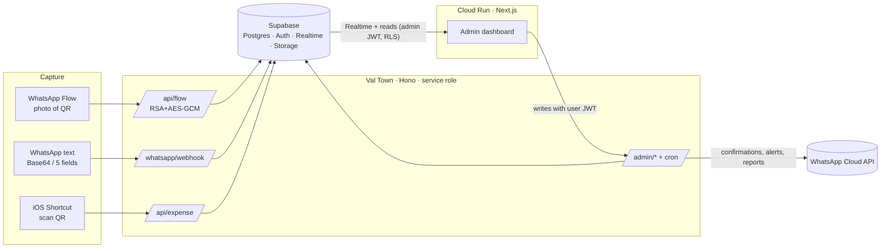

# Eman Expenses – Expense Capture + Admin Console

Purchase invoices (ZATCA Phase 1/2 QR codes) are captured by staff from **WhatsApp** (Flow or plain text) or an
**iOS Shortcut**, stored in **Supabase**, and shown **live** in this admin dashboard. Everything that may change later
(users, categories, VAT rate, thresholds, report schedule, message texts, feature switches) is data with a UI.

> **Status:** code, tests and the Val Town backend are done and verified locally. Supabase migrations, Cloud Run and the
> Meta/WhatsApp setup still need *your* credentials – see [docs/test-report.md](docs/test-report.md) for exactly what
> was and was not verified, and the [deploy checklist](#deploy-checklist) below.

## Architecture



| Concern | Where |
|---|---|
| Capture endpoints, webhook, Flow endpoint, admin API, cron | `valtown/` → Val Town (Deno + Hono) |
| Schema, RLS, triggers, seed | `supabase/migrations/` |
| WhatsApp Flow definition + setup script | `whatsapp/flow.json`, `valtown/scripts/flow-setup.mjs` |
| Dashboard (Next.js 16, shadcn/ui, Tailwind 4) | `src/` |
| Container, CI/CD | `Dockerfile`, `.github/workflows/`, `scripts/deploy-cloud-run.sh` |
| Guides | `docs/` |

**Data flow rules.** Capture channels → Val Town → Supabase with the **service role key (server-side only)**. The dashboard
*reads and subscribes to Realtime directly* from Supabase with the logged-in admin's session (RLS enforced). Every
dashboard *write* goes through the Val Town admin API with the user's Supabase JWT, so each change is audited
server-side (the DB trigger records the admin's email as the actor).

## Environment variables

Never hard-coded, never logged (the logger redacts anything named like a secret).

**Dashboard (Cloud Run, from Secret Manager)** – read at *request time* and handed to the browser through
`window.__ENV__`, so one image runs anywhere:

| Variable | Notes |
|---|---|
| `NEXT_PUBLIC_SUPABASE_URL` | project URL |
| `NEXT_PUBLIC_SUPABASE_ANON_KEY` | public anon key (RLS is the protection) |
| `NEXT_PUBLIC_ADMIN_API_URL` | Val Town base URL |

**Val Town**: `SUPABASE_URL`, `SUPABASE_SERVICE_ROLE_KEY`, `SUPABASE_JWT_SECRET` (or leave empty: JWKS is used),
`WA_TOKEN`, `WA_PHONE_NUMBER_ID`, `WA_WABA_ID`, `WA_APP_SECRET`, `WA_VERIFY_TOKEN`, `WA_FLOW_PRIVATE_KEY`,
`WA_FLOW_PRIVATE_KEY_PASSPHRASE`, `ALLOWED_ORIGIN` (the Cloud Run URL). Template: `valtown/.env.example`.

The service role key never reaches the frontend or the browser.

## Setup (local)

```bash
npm install && npm --prefix valtown install
cp .env.example .env.local        # fill in
npm run dev                       # dashboard on :3000
npm test                          # frontend + backend + RLS tests (no external services needed)
npm run build && npm run e2e      # browser end-to-end against a local Supabase look-alike
```

## Key design decisions

* **Duplicates**: unique `(vat_number, invoice_date, total_amount)` as specified, plus a unique index on `raw_qr`, so editing
  the total in the WhatsApp confirmation screen cannot be used to re-submit the same invoice. Duplicate attempts increment
  `duplicate_count` (shown as a badge) and alert admins.
* **VAT warning** (not a rejection): flagged when VAT differs from `vat_rate` × net by more than `0.05 + 0.5 %` of net. The rate is the
  `vat_rate` setting; the rule lives in a DB trigger and is mirrored in the API.
* **QR time**: ZATCA timestamps are Saudi local time; naive and `Z` values are read as UTC+3. Dates display as dd/MM/yyyy (Riyadh).
* **Tokens**: 256-bit random, only the SHA-256 hash is stored, shown once on generation/rotation. Failed attempts are throttled.
* **Shortcut sends the raw QR text**; the server parses TLV itself (more reliable than parsing binary inside Shortcuts).
* **WhatsApp Flow is stateless**: the confirmation screen carries the raw QR; it is re-parsed on submit, so a tampered client
  can only change total / category / notes. Flow sessions are bound to the sender by an HMAC-signed, expiring `flow_token`.
* **Reports**: cron fires hourly; *when* to send comes from `report_schedule` (Saudi hours) so schedules are editable in the UI.
  Business-initiated WhatsApp messages outside the 24 h window need an approved template: set `wa_notify_template` in Settings.
* **Auth**: Supabase email+password and magic link (`shouldCreateUser: false`). `proxy.ts` blocks anonymous visitors; the dashboard
  layout additionally requires an *active* `app_users` row with role `admin` (otherwise the "Not authorized" page).
* **Export**: CSV (UTF-8 BOM, formula-injection safe) and Excel-readable `.xls`.
* Unused template demo pages, demo data and demo auth were removed. `src/components/ui` and `src/components/calendar` are untouched.

## Deploy checklist

1. **Supabase** – create the admin user in *Authentication → Users*, apply migrations
   (`supabase link --project-ref … && supabase db push`, or paste the four files from `supabase/migrations/` into the SQL editor in order),
   then `select public.bootstrap_admin('you@company.com','Your Name','+9665…');`. In *Authentication → URL configuration* add the dashboard URL (for magic links).
2. **Val Town** – env vars from the table above; code is in `applications/eman-expense-api` (sync with `node valtown/scripts/sync.mjs`).
3. **Dashboard** – `PROJECT_ID=… ./scripts/deploy-cloud-run.sh` or push to `main` with the GitHub Actions secrets in [docs/deployment.md](docs/deployment.md). Then put the Cloud Run URL into Val Town `ALLOWED_ORIGIN`.
4. **WhatsApp** – follow [docs/deployment.md#meta-whatsapp-setup](docs/deployment.md#meta-whatsapp-setup) (webhook, Flow public key, Flow creation, `wa_flow_id` setting).
5. **People** – Users page: add staff, WhatsApp numbers, sections; generate Shortcut tokens; build the Shortcut ([docs/ios-shortcut.md](docs/ios-shortcut.md)).
6. **Smoke test** – send a sample through each channel and watch the dashboard (commands in [docs/test-report.md](docs/test-report.md)).
